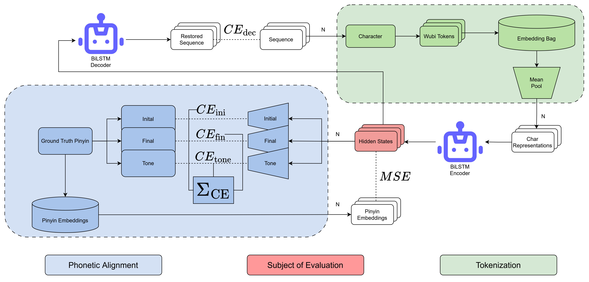
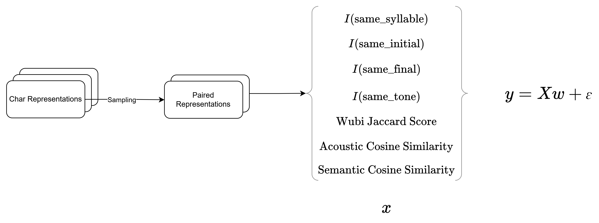
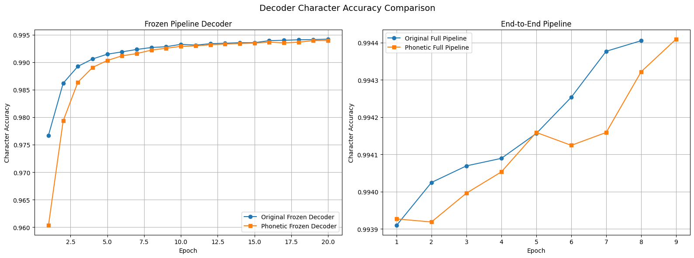
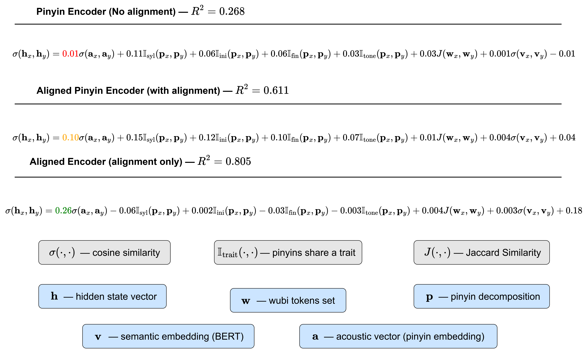

# Mandarin Phonetics Modeling

> Shaping and probing the **hidden representation space** of Mandarin encoders through **acoustic alignment**.

## Key Findings

- **Pinyin prediction alone does not yield a phonetically organized space.** Hidden-space similarity is driven mainly by discrete pinyin categories and, for the BiLSTM, by visual Wubi overlap.
- **Acoustic alignment reshapes the geometry.** Adding a continuous acoustic target raises the explanatory power of acoustic similarity from $R^2 = 0.268$ (pinyin encoder) to $0.611$ (pinyin-aligned) and $0.805$ (aligned), after PCA.
- **Alignment compresses the manifold.** The number of principal components needed to explain 90% of the variance drops from **497 → 332 → 67** across the three objectives.
- **The geometry shows up behaviorally.** As alignment strengthens, decoders recover the original lexical item instead of copying a perturbed homophone (recovery $0.018 \rightarrow 0.654$ for LSTM).
- **The effect is architecture-independent.** The same trend reproduces with BERT encoders despite their different inductive bias, confirming it comes from the alignment objective rather than the architecture.

## Motivation

> In many representation learning tasks, the objective is not only to distinguish between classes but to organize the **hidden representation space** according to a desired notion of similarity, such as phonetic, semantic, or visual relatedness. We study this problem through Mandarin phonetic representation learning by comparing three encoder objectives: a **pinyin encoder** trained for phonetic prediction, a **pinyin-aligned encoder** jointly optimized for pinyin prediction and **acoustic alignment**, and an **aligned encoder** trained solely to match continuous acoustic embeddings. Across both BiLSTM and BERT architectures, we investigate three complementary strategies for shaping hidden representations: **a shared sub-character input basis** (Wubi decomposition), **a continuous acoustic target space** derived from wav2vec2 speech embeddings, and **dimensionality reduction** to reveal latent structure. To explain the resulting representations, we introduce a probing framework that combines interpretable regression analysis with a homophone reconstruction benchmark, allowing us to disentangle the contributions of visual, phonetic, acoustic, and semantic factors to hidden-space organization.

## Training Pipeline

### Pipeline objectives

The three encoders differ only in how the encoder is supervised, controlled by the **acoustic alignment** term (MSE against wav2vec2 embeddings):

$$
\mathcal{L}_{\text{pinyin}}=\text{CE}_{\text{dec}} + \mathbb{\lambda}_{\text{enc}} \Sigma_{\text{CE}}
$$

$$
\mathcal{L}_{\text{pinyin-aligned}}=\text{CE}_{\text{dec}} + \mathbb{\lambda}_{\text{enc}} (\Sigma_{\text{CE}} + \mathbb{\lambda}_{\text{MSE}} \text{MSE})
$$

$$
\mathcal{L}_{\text{aligned}}=\text{CE}_{\text{dec}} + \mathbb{\lambda}_{\text{enc}} \text{MSE}
$$

## Evaluation Method

## Results

The results follow one storyline: **acoustic alignment** first perturbs the optimization, then reshapes the **hidden representation space**, and finally changes how decoders behave when probed.

### 1. Optimization dynamics

Introducing **acoustic alignment** into the encoder objective measurably perturbs decoder training, costing **-1.64% after the first epoch**. This is the first sign that the alignment pressure is competing with the pinyin objective rather than simply riding along with it.

### 2. Hidden geometry

Regression analysis explains hidden-space similarity in terms of visual, phonetic, acoustic, and semantic factors. As **acoustic alignment** strengthens, acoustic similarity becomes the dominant explanatory factor and the **hidden representation space** collapses into a progressively lower-dimensional manifold:

| Objective | Acoustic $R^2$ (post-PCA) | PCs for 90% variance |
| :-------- | ------------------------: | -------------------: |
| Pinyin encoder | 0.268 | 497 |
| Pinyin-aligned encoder | 0.611 | 332 |
| Aligned encoder | **0.805** | **67** |

Full coefficient tables, EDA, and SHAP interpretability results are available in this [multi-page diagram](https://viewer.diagrams.net/?tags=%7B%7D&lightbox=1&highlight=0000ff&edit=_blank&layers=1&nav=1&title=Regression.drawio&dark=auto#Uhttps%3A%2F%2Fdrive.google.com%2Fuc%3Fid%3D1W-LC8AjJy-AxZTbzUfHF3dNrhw-hKX1Z%26export%3Ddownload).

### 3. Probing

The geometric change is confirmed behaviorally. Each perturbed homophone bigram is passed through an encoder and reconstructed by its decoder; a high **recovery** rate means the hidden state discarded character identity and kept only phonetic information, while a high **copy** rate means it preserved character identity. The representative LSTM target-position outcome:

| Metric       | Pinyin Encoder | Pinyin-Aligned Encoder | Aligned Encoder |
| :----------- | -------------: | ---------------------: | --------------: |
| **Recovery** |          0.018 |                  0.042 |       **0.654** |
| **Copy**     |          0.768 |                  0.725 |       **0.077** |

As alignment strengthens, recovery rises and copying collapses — hidden states progressively fold character-specific information into shared phonetic representations. The same qualitative trend reproduces with BERT encoders (recovery $0.081 \rightarrow 0.434$), confirming the effect is driven by the objective, not the architecture. Comprehensive phrase-level and BERT tables are reported in the paper.

## Conclusion

We find that optimizing an encoder only for pinyin prediction does not naturally produce a **hidden representation space** organized by phonetic similarity. Instead, hidden-state similarity is primarily explained by discrete pinyin categories and, for the BiLSTM encoder, by visual Wubi overlap. Introducing explicit **acoustic alignment** with continuous embeddings fundamentally changes this geometry: the **pinyin-aligned encoder** substantially increases the explanatory power of acoustic similarity, while the **aligned encoder** makes it the dominant factor, increasing the regression fit from **$R^2=0.268$** for the pinyin encoder to **$0.611$** and **$0.805$**, respectively, after PCA. Alignment also concentrates the representations into progressively lower-dimensional manifolds, reducing the number of principal components required to explain 90% of the variance from **497** to **332** and finally **67**.

These structural changes are reflected behaviorally in the homophone probing benchmark. As alignment strengthens, decoders become increasingly likely to recover the original lexical item rather than copying the perturbed homophone, indicating that hidden states progressively collapse character-specific information into shared phonetic representations. The same qualitative trend is reproduced with BERT encoders, despite their substantially different inductive bias, demonstrating that the effect arises from the alignment objective rather than the encoder architecture. Overall, the study shows that explicit continuous supervision can reshape neural representations from discrete symbolic categories toward graded similarity spaces, providing a practical framework for both learning and interpreting structured latent representations beyond Mandarin phonetics.

## Data & Local Setup

The current workflow uses the supplied DuYu/Pinyin-Hanzi annotations and Chinese Lessons audio. Composite notebooks find the project root automatically and import the shared SDK from `src`. Portable notebooks contain the required implementation and use explicit input/output paths.

The findings above describe the historical research. Its former notebooks and generated data are retained in Git history; the current notebooks prepare reproducible experiments and DIMSIM evaluations.

### `datasets/` layout

| Folder | Contents | Storage |
| :-- | :-- | :-- |
| `chinese-lessons.zip` | Source archive for local audio extraction | Git |
| `source-data/` | Local DuYu export, sounds and sound manifests | Ignored |
| `wubi/` | Character/Wubi dictionaries | Git |
| `pinyin-embeddings/` | Complete base and zh-cn acoustic bundles | Git |
| `processed-corpus/` | Filtered and sampled corpus with audit reports | Ignored |
| `prepared/` | Validated corpus, embeddings and Wubi assembled together | Ignored |
| `experiments/<experiment_id>/` | Splits, vocabularies and model initialization | Generated; tracked config/manifest exceptions |
| `runs/<experiment_id>/` | Training checkpoints, metrics and configuration | Ignored |
| `evaluations/<evaluation_id>/` | Immutable DIMSIM evaluation bundle | Generated; tracked config/manifest/coverage exceptions |
| `evaluation-runs/` | Representation analysis, metrics and comparisons | Ignored |

Relative paths `corpus/train.csv` and `embeddings/pinyin_embeddings.pkl` remain part of the prepared-bundle contract. They are internal to that bundle.

### Run order

1. Export the pinned DuYu split in `prepare-corpus`. When the local export already exists, skip the export call.
2. Unpack `chinese-lessons.zip` and build the sound manifest in `prepare-sounds`.
3. Select an existing validated acoustic bundle, or run the portable/composite `prepare-pinyin-embeddings` notebook with an exact model revision.
4. Run the local processing section of `prepare-corpus`: normalization, validation, exclusion of conflicting pronunciations, Wubi/audio coverage, deduplication and reproducible sampling. Current sample size is 100,000 rows with seed 42.
5. Run `prepare-data` to assemble the processed corpus, Wubi and compatible embeddings without modifying their contents.
6. Run `prepare-experiment` against that prepared bundle to create the train/validation/test splits and initialization.
7. Train the selected objective: `ce_only`, `combined` or `mse_only`. Keep the experiment ID and seed consistent across comparisons.
8. Run `prepare-evaluation` for the exact experiment and split, then geometry analysis with matching checkpoints. The evaluation runner checks experiment/checkpoint provenance; old weights must not be substituted for a new corpus.

Training writes `datasets/runs/<experiment_id>/<condition>/seed-<seed>/best.pt`; the combined condition additionally uses `lambda-<value>/` before the seed directory. Geometry analysis checks that configured checkpoints exist before starting.

## Notebooks

### Data preparation

- [prepare-corpus.ipynb](notebooks/Datasets/Data%20Preparation/prepare-corpus.ipynb): pinned DuYu export and local corpus processing.
- [prepare-sounds.ipynb](notebooks/Datasets/Data%20Preparation/prepare-sounds.ipynb): archive extraction and audited sound manifest.
- [prepare-pinyin-embeddings.ipynb](notebooks/Datasets/Data%20Preparation/prepare-pinyin-embeddings.ipynb): portable acoustic inference; [Kaggle inference](https://www.kaggle.com/code/davidvista/wav2vec2-embeddings-v1).
- [prepare-pinyin-embeddings-composite.ipynb](notebooks/Datasets/Data%20Preparation/prepare-pinyin-embeddings-composite.ipynb): acoustic inference using the local SDK.
- [prepare-data.ipynb](notebooks/Datasets/Data%20Preparation/prepare-data.ipynb): strict artifact assembly.
- [prepare-experiment.ipynb](notebooks/Datasets/Experiment%20Setup/prepare-experiment.ipynb): experiment splits and initialization.
- [prepare-evaluation.ipynb](notebooks/Datasets/Evaluation%20Setup/prepare-evaluation.ipynb): pinned DIMSIM evaluation inputs.

### Training

Each objective has a portable notebook and a composite notebook importing the local SDK.

| Objective | Portable | Composite |
| :-- | :-- | :-- |
| Pinyin prediction | [Pinyin Model](notebooks/Training/Pinyin%20Model/wubi-tokenizer-mandarin-encoder.ipynb) | [Composite](notebooks/Training/Pinyin%20Model/wubi-tokenizer-mandarin-encoder-composite.ipynb) |
| Combined prediction and alignment | [Pinyin Aligned Model](notebooks/Training/Pinyin%20Aligned%20Model/phonetic-aware-representaions-learning.ipynb) | [Composite](notebooks/Training/Pinyin%20Aligned%20Model/phonetic-aware-representaions-learning-composite.ipynb) |
| Acoustic alignment | [Aligned Model](notebooks/Training/Aligned%20Model/pure-phonetic-encoder.ipynb) | [Composite](notebooks/Training/Aligned%20Model/pure-phonetic-encoder-composite.ipynb) |

### Evaluation and utilities

- [geometry-analysis.ipynb](notebooks/Evaluation/geometry-analysis.ipynb): portable geometry evaluation.
- [geometry-analysis-composite.ipynb](notebooks/Evaluation/geometry-analysis-composite.ipynb): geometry evaluation using the local SDK.
- [dimsim-distribution-analysis.ipynb](notebooks/DIMSIM/dimsim-distribution-analysis.ipynb): DIMSIM distance distribution analysis.
- [wubi-tokenizer.ipynb](notebooks/Tokenization/wubi-tokenizer.ipynb): Wubi dictionary construction and inspection.
