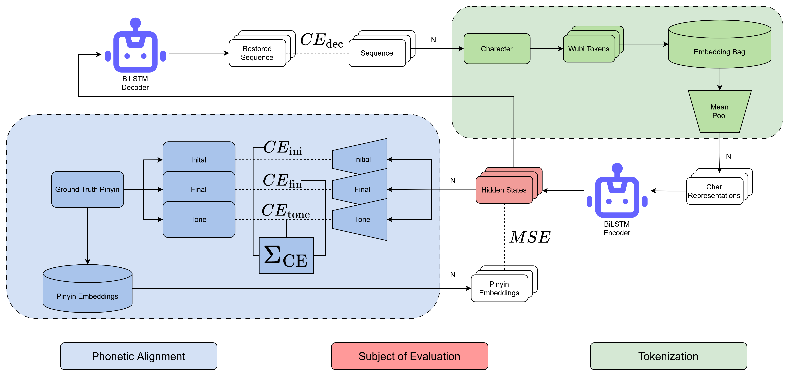
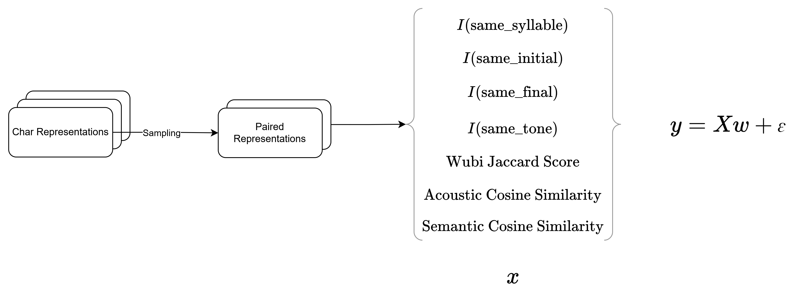
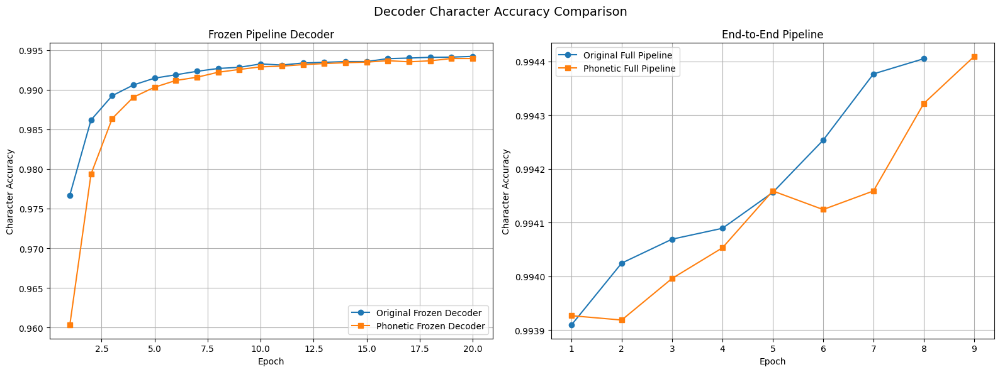
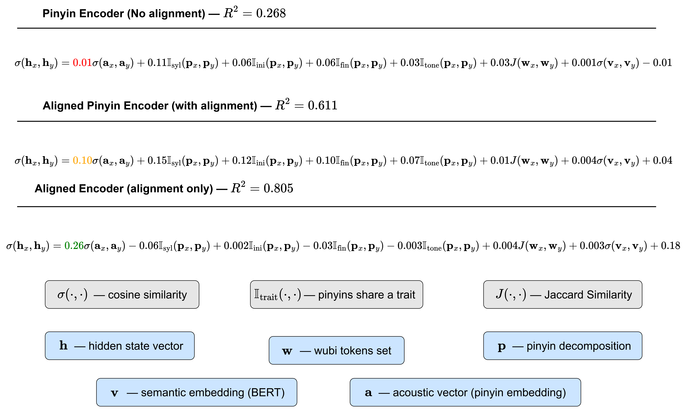

# Mandarin Phonetics Modeling

> Shaping and probing the **hidden representation space** of Mandarin encoders through **acoustic alignment**.

## Key Findings

- **Pinyin prediction alone does not yield a phonetically organized space.** Hidden-space similarity is driven mainly by discrete pinyin categories and, for the BiLSTM, by visual Wubi overlap.
- **Acoustic alignment reshapes the geometry.** Adding a continuous acoustic target raises the explanatory power of acoustic similarity from $R^2 = 0.268$ (pinyin encoder) to $0.611$ (pinyin-aligned) and $0.805$ (aligned), after PCA.
- **Alignment compresses the manifold.** The number of principal components needed to explain 90% of the variance drops from **497 → 332 → 67** across the three objectives.
- **The geometry shows up behaviorally.** As alignment strengthens, decoders recover the original lexical item instead of copying a perturbed homophone (recovery $0.018 \rightarrow 0.654$ for LSTM).
- **The effect is architecture-independent.** The same trend reproduces with BERT encoders despite their different inductive bias, confirming it comes from the alignment objective rather than the architecture.

## Motivation

> In many representation learning tasks, the objective is not only to distinguish between classes but to organize the **hidden representation space** according to a desired notion of similarity, such as phonetic, semantic, or visual relatedness. We study this problem through Mandarin phonetic representation learning by comparing three encoder objectives: a **pinyin encoder** trained for phonetic prediction, a **pinyin-aligned encoder** jointly optimized for pinyin prediction and **acoustic alignment**, and an **aligned encoder** trained solely to match continuous acoustic embeddings. Across both BiLSTM and BERT architectures, we investigate three complementary strategies for shaping hidden representations: **a shared sub-character input basis** (Wubi decomposition), **a continuous acoustic target space** derived from wav2vec2 speech embeddings, and **dimensionality reduction** to reveal latent structure. To explain the resulting representations, we introduce a probing framework that combines interpretable regression analysis with a homophone reconstruction benchmark, allowing us to disentangle the contributions of visual, phonetic, acoustic, and semantic factors to hidden-space organization.

## Training Pipeline



### Pipeline objectives

The three encoders differ only in how the encoder is supervised, controlled by the **acoustic alignment** term (MSE against wav2vec2 embeddings):

$$
\mathcal{L}_{\text{pinyin}}=\text{CE}_{\text{dec}} + \mathbb{\lambda}_{\text{enc}} \Sigma_{\text{CE}}
$$

$$
\mathcal{L}_{\text{pinyin-aligned}}=\text{CE}_{\text{dec}} + \mathbb{\lambda}_{\text{enc}} (\Sigma_{\text{CE}} + \mathbb{\lambda}_{\text{MSE}} \text{MSE})
$$

$$
\mathcal{L}_{\text{aligned}}=\text{CE}_{\text{dec}} + \mathbb{\lambda}_{\text{enc}} \text{MSE}
$$

## Evaluation Method



## Results

The results follow one storyline: **acoustic alignment** first perturbs the optimization, then reshapes the **hidden representation space**, and finally changes how decoders behave when probed.

### 1. Optimization dynamics

Introducing **acoustic alignment** into the encoder objective measurably perturbs decoder training, costing **-1.64% after the first epoch**. This is the first sign that the alignment pressure is competing with the pinyin objective rather than simply riding along with it.



### 2. Hidden geometry

Regression analysis explains hidden-space similarity in terms of visual, phonetic, acoustic, and semantic factors. As **acoustic alignment** strengthens, acoustic similarity becomes the dominant explanatory factor and the **hidden representation space** collapses into a progressively lower-dimensional manifold:

| Objective | Acoustic $R^2$ (post-PCA) | PCs for 90% variance |
| :-------- | ------------------------: | -------------------: |
| Pinyin encoder | 0.268 | 497 |
| Pinyin-aligned encoder | 0.611 | 332 |
| Aligned encoder | **0.805** | **67** |



Full coefficient tables, EDA, and SHAP interpretability results are available in this [multi-page diagram](https://viewer.diagrams.net/?tags=%7B%7D&lightbox=1&highlight=0000ff&edit=_blank&layers=1&nav=1&title=Regression.drawio&dark=auto#Uhttps%3A%2F%2Fdrive.google.com%2Fuc%3Fid%3D1W-LC8AjJy-AxZTbzUfHF3dNrhw-hKX1Z%26export%3Ddownload).

### 3. Probing

The geometric change is confirmed behaviorally. Each perturbed homophone bigram is passed through an encoder and reconstructed by its decoder; a high **recovery** rate means the hidden state discarded character identity and kept only phonetic information, while a high **copy** rate means it preserved character identity. The representative LSTM target-position outcome:

| Metric       | Pinyin Encoder | Pinyin-Aligned Encoder | Aligned Encoder |
| :----------- | -------------: | ---------------------: | --------------: |
| **Recovery** |          0.018 |                  0.042 |       **0.654** |
| **Copy**     |          0.768 |                  0.725 |       **0.077** |

As alignment strengthens, recovery rises and copying collapses — hidden states progressively fold character-specific information into shared phonetic representations. The same qualitative trend reproduces with BERT encoders (recovery $0.081 \rightarrow 0.434$), confirming the effect is driven by the objective, not the architecture. Comprehensive phrase-level and BERT tables are reported in the paper.

## Conclusion

We find that optimizing an encoder only for pinyin prediction does not naturally produce a **hidden representation space** organized by phonetic similarity. Instead, hidden-state similarity is primarily explained by discrete pinyin categories and, for the BiLSTM encoder, by visual Wubi overlap. Introducing explicit **acoustic alignment** with continuous embeddings fundamentally changes this geometry: the **pinyin-aligned encoder** substantially increases the explanatory power of acoustic similarity, while the **aligned encoder** makes it the dominant factor, increasing the regression fit from **$R^2=0.268$** for the pinyin encoder to **$0.611$** and **$0.805$**, respectively, after PCA. Alignment also concentrates the representations into progressively lower-dimensional manifolds, reducing the number of principal components required to explain 90% of the variance from **497** to **332** and finally **67**.

These structural changes are reflected behaviorally in the homophone probing benchmark. As alignment strengthens, decoders become increasingly likely to recover the original lexical item rather than copying the perturbed homophone, indicating that hidden states progressively collapse character-specific information into shared phonetic representations. The same qualitative trend is reproduced with BERT encoders, despite their substantially different inductive bias, demonstrating that the effect arises from the alignment objective rather than the encoder architecture. Overall, the study shows that explicit continuous supervision can reshape neural representations from discrete symbolic categories toward graded similarity spaces, providing a practical framework for both learning and interpreting structured latent representations beyond Mandarin phonetics.

## Data and local setup

The current character-level pipeline uses pinned DuYu/Pinyin-Hanzi annotations and Chinese Lessons audio. The research findings above describe historical experiments. Historical evaluation notebooks retain their original protocol; character-experiment evaluation is a separate migration.

Use Python 3.12. Install the project from the committed lock without ML dependencies:

```sh
uv sync --frozen --extra sources --extra audio --extra test
uv run --frozen --no-sync phonetics --help
```

The base runtime pins NumPy 2.1.3 and pypinyin 0.55.0. Optional `training` and `inference` dependencies pin Torch 2.11.0. Select the appropriate CPU/CUDA build explicitly for the intended device. Preparation does not install or import Torch automatically. The historical research environment remains documented in `requirements.txt`; it is not the installation specification for this pipeline.

Copy `configs/experiment.example.json` to a configuration file in the same directory and review paths, exact source/model revisions and acoustic manifest hash. Paths resolve relative to that configuration file, independently of the working directory. Moving the config elsewhere requires adjusting relative paths.

```sh
phonetics download-sounds --output datasets/source-data/chinese-lessons-v1
phonetics export-corpus --config configs/experiment.json
phonetics prepare-inventory --config configs/experiment.json
phonetics prepare-corpus --config configs/experiment.json
phonetics prepare-embeddings --config configs/experiment.json
phonetics prepare-data --config configs/experiment.json
phonetics prepare-experiment --config configs/experiment.json
```

Alternatively, `phonetics prepare --config configs/experiment.json` runs the complete preparation sequence and passes artifact identities between stages. The example imports the existing pinned zh-cn acoustic bundle without inference. To compute new targets, set both acoustic input fields to null and supply `--allow-inference`. Review model revision and device first.

The source stage downloads the official Mandarin Sounds ZIP from [Chinese Lessons](https://www.chinese-lessons.com/download.htm), verifies its SHA256, and stores the archive and attribution/license provenance in an ignored local source directory. Audio is not distributed with the current source tree. The download page specifies CC BY-NC-ND 3.0 US; retain attribution and observe the source's conditions.

The decoded sound inventory is independent of acoustic embeddings. Corpus processing applies normalization, alignment, pronunciation-conflict exclusion, deduplication and sound coverage, with no IDS dependency or sampling. Prepared data assembly checks inventory/target compatibility without removing more sentences.

Each seed samples an explicit N sentences for train plus validation. The example uses N=100000: 90000 train, 10000 validation per seed, and one additional common test of 10000. Test sentences are removed before seed sampling. Each seed builds its own train-only character vocabulary (PAD=0, UNK=1); all objectives of that seed share splits, vocabulary and initial encoder weights. The input encoder is a 64-dimensional character embedding followed by the sentence BiLSTM. Existing outputs are reused only after content and configuration validation; changed inputs require a new output ID.

Training is separate and requires explicit input provenance and device:

```sh
phonetics train --experiment datasets/experiments/char-zh-cn-v1 --manifest-sha256 EXACT_SHA256 --model syllable --device cpu --output runs --allow-training
```

Training writes `runs/<experiment_id>/<model_id>/<run_id>/seed-<seed>/{best,last}.pt`. Manifests bind actual seeds, per-seed splits/vocabularies, common test, code, runtime and checkpoints. Data splits and vocabularies are deterministic; GPU results are not promised to be bitwise identical across systems.

| Directory | Contents |
| :-- | :-- |
| `datasets/source-data/` | Downloaded source bundles, DuYu exports, decoded inventory and cache; ignored |
| `datasets/processed-corpus/` | Complete eligible character corpus and rejection reports; ignored |
| `datasets/pinyin-embeddings/` | Existing acoustic references and newly generated targets |
| `datasets/prepared/` | Validated corpus and acoustic targets; ignored |
| `datasets/experiments/` | Shared corpus/test and per-seed splits, vocabularies and diagnostics |
| `runs/` | Separate immutable training runs; ignored |

## Notebooks

Standalone preparation and training notebooks contain readable `%%writefile` source cells and verify the resulting SDK snapshot before importing it. They do not need a project checkout. Configuration and execution guards appear at the end; dependency installation and inference/training are never automatic. Local execution uses the CLI instead of composite notebooks.

### Preparation

- [Sound sources](notebooks/Datasets/Data%20Preparation/prepare-sounds.ipynb)
- [Character corpus](notebooks/Datasets/Data%20Preparation/prepare-corpus.ipynb)
- [Acoustic targets](notebooks/Datasets/Data%20Preparation/prepare-pinyin-embeddings.ipynb)
- [Prepared data](notebooks/Datasets/Data%20Preparation/prepare-data.ipynb)
- [Experiment](notebooks/Datasets/Experiment%20Setup/prepare-experiment.ipynb)

### Training

- [Syllable](notebooks/Training/syllable/syllable.ipynb)
- [Components](notebooks/Training/components/components.ipynb)
- [Acoustic](notebooks/Training/acoustic/acoustic.ipynb)
- [Components and acoustic](notebooks/Training/components-acoustic/components-acoustic.ipynb); select lambda 1 or 10 explicitly.

### Evaluation and reports

- [contextual-evaluation.ipynb](notebooks/Evaluation/contextual-evaluation.ipynb): standalone contextual extraction and numerical evaluation.
- [contextual-evaluation-composite.ipynb](notebooks/Evaluation/contextual-evaluation-composite.ipynb): the same data pipeline using the local SDK.
- [evaluation.ipynb](notebooks/Visualization/evaluation.ipynb): figures and tables from completed evaluation artifacts.
- [dimsim-distribution-analysis.ipynb](notebooks/Report/dimsim-distribution-analysis.ipynb): DIMSIM distance distribution report.
- [dimsim-parser-alignment.ipynb](notebooks/Report/dimsim-parser-alignment.ipynb): DIMSIM parser comparison report.
- [wav2vec2-graduality-comparison.ipynb](notebooks/Report/wav2vec2-graduality-comparison.ipynb): Wav2Vec2 representation comparison report.
